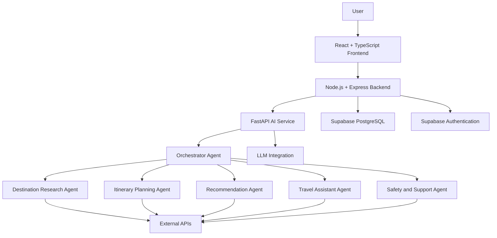
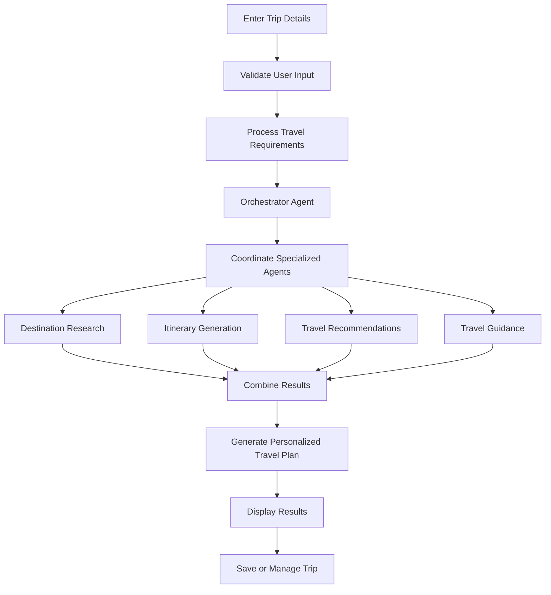

#  Jatayuv AI - Agentic AI Universal Travel Ecosystem
https://jatayuv-ai.vercel.app/

**Plan smarter. Explore farther. Travel your way.**

Jatayuv AI is an AI-powered travel planning platform designed to simplify the entire travel-planning experience. It helps users discover destinations, generate personalized itineraries, explore places, and organize their trips based on their budget, interests, travel duration, and preferences.

Instead of switching between multiple applications to plan a trip, Jatayuv AI brings travel planning, destination discovery, itinerary generation, and trip management together in one platform.

---

## ✨ Overview

Travel planning often involves researching destinations, finding attractions, checking routes, estimating budgets, and organizing daily activities across multiple platforms.

Jatayuv AI addresses this problem through an AI-assisted travel ecosystem that combines intelligent itinerary generation, personalized recommendations, location-based information, and trip management.

The platform follows a modular, agent-oriented architecture designed to divide travel-planning tasks into specialized responsibilities and provide a more organized travel experience.

---

## 🚀 Features

- **AI-Powered Itinerary Generation** – Generate personalized day-wise travel plans based on destination, duration, budget, interests, and travel preferences.
- **Destination Discovery** – Explore destinations and discover places that match your travel interests.
- **Personalized Travel Recommendations** – Get travel suggestions tailored to your preferences.
- **Trip Management** – Organize and manage your travel plans in one place.
- **Saved Trips** – Save itineraries and access your travel plans later.
- **Wishlist** – Save destinations and places you wish to explore.
- **Travel History** – Keep track of previous trip plans and searches.
- **Map & Location Integration** – Explore destinations and understand the geographical locations of places.
- **AI Travel Assistance** – Get AI-assisted support during the travel-planning process.
- **User Authentication** – Secure user account access and personalized travel data.

---

## 🧠 Agentic AI Architecture

Jatayuv AI is designed around a modular agent-based workflow coordinated by an **Orchestrator Agent**.

The architecture separates travel-planning responsibilities into specialized agents, allowing different tasks to be processed independently and combined into a unified travel-planning response.

### Specialized Agents

| Agent | Responsibility |
|---|---|
| Orchestrator Agent | Coordinates the travel-planning workflow and combines agent outputs. |
| Destination Research Agent | Helps gather and organize destination-related information. |
| Itinerary Planning Agent | Creates structured, day-wise travel itineraries. |
| Experience & Recommendation Agent | Suggests attractions, activities, and travel experiences. |
| Travel Assistant Agent | Provides travel-related assistance and guidance. |
| Safety & Support Agent | Supports safety-related information and travel guidance. |

### Agent Workflow

1. The user submits travel requirements.
2. The backend validates and processes the request.
3. The Orchestrator Agent identifies and coordinates the relevant tasks.
4. Specialized agents process their respective travel-planning responsibilities.
5. The system combines the generated information.
6. The final travel plan and recommendations are presented to the user.

---

## 🏗️ System Architecture

Jatayuv AI follows a modular full-stack architecture that separates the frontend, backend API, AI processing service, database, and external integrations.



---

## 🛠️ Tech Stack

### Frontend
- React.js
- TypeScript
- Vite
- Tailwind CSS

### Backend
- Node.js
- Express.js
- REST APIs

### AI & Agentic System
- Agentic AI Architecture
- Orchestrator and specialized agents
- Google Gemini API / compatible LLM integrations

### AI Service
- Python
- FastAPI
- Uvicorn

### Database & Authentication
- Supabase
- PostgreSQL
- Supabase Authentication

### Maps & Location Services
- OpenStreetMap
- Leaflet.js
- Nominatim

### External Integrations
- AI model APIs
- Weather data services
- Destination and location services

---

## 🔄 End-to-End Workflow



---

## 📂 Project Structure

```text
Jatayuv-AI/
│
├── frontend/              # React + TypeScript application
│   ├── src/
│   ├── public/
│   └── ...
│
├── backend/               # Backend API and server-side logic
│   ├── routes/
│   ├── controllers/
│   ├── services/
│   └── ...
│
├── .gitignore
└── README.md
```

*The internal folder structure may evolve as the application develops.*

---

## 🎯 Project Objectives

- Simplify the travel-planning process through a unified platform.
- Generate personalized travel itineraries using AI.
- Organize travel planning through an agent-based architecture.
- Provide destination discovery and travel recommendations.
- Integrate external services for travel-related information.
- Maintain user trips, wishlists, and travel-related data.
- Build a modular, scalable, and maintainable full-stack application.

---

## 🔮 Future Enhancements

- Real-time weather-based itinerary adjustments.
- Smart route and travel-time optimization.
- Budget breakdown and expense tracking.
- Accommodation and restaurant recommendations.
- Travel alerts and destination updates.
- Collaborative trip planning.
- Multilingual travel assistance.
- Offline access to saved itineraries.
- Booking platform integrations.

---

## 👩‍💻 Project Team

- **Renikunta Likith**
- **MamidiPaka Kala Sahithi**
- **Mandadapu Kinnera**

### Academic Project

Bachelor of Technology — Computer Science

Malla Reddy University

Academic Year: 2026–2027


## 🌍 Vision

To make travel planning more intelligent, personalized, and effortless by combining artificial intelligence, agent-based automation, location intelligence, and travel management into one connected ecosystem.


<p align="center">
  <b>Jatayuv AI — Your Journey, Intelligently Planned.</b>
</p>
